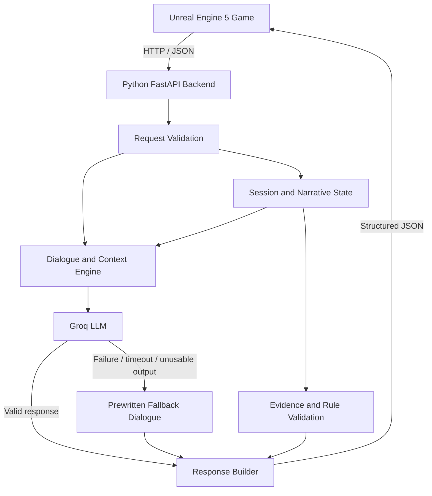

# ORPHEUS: The Last Route

> **A psychological mystery where conversations change the game.**
>
> FARLANDS 2026 · Innovation Mission 5 — Cognitive NPCs: Conversational Dialogue Systems  
> Team: **The Mavericks**

ORPHEUS is a conversational-NPC game prototype set around a dangerous research facility. Instead of relying only on fixed dialogue trees, the project connects natural-language interaction with narrative context, player memory, discovered evidence, trust, suspicion, and controlled game-state changes.

The project is designed to explore a central question:

**What if talking to an NPC could change what happens next?**

> **Project status:** The Python AI/backend contains dialogue, narrative-state, memory, evidence-validation, fallback, and ending-related logic. The full experience still needs to be validated end-to-end inside Unreal Engine. Backend implementation should not be described as proof that every feature or ending is already playable in the game.

---

## Table of Contents

- [Overview](#overview)
- [The Problem](#the-problem)
- [Our Approach](#our-approach)
- [What Makes ORPHEUS Different](#what-makes-orpheus-different)
- [Core Features](#core-features)
- [Architecture](#architecture)
- [Technology Stack](#technology-stack)
- [Repository Layout](#repository-layout)
- [Requirements](#requirements)
- [Getting Started](#getting-started)
- [Configuration and Secrets](#configuration-and-secrets)
- [Running the Backend](#running-the-backend)
- [API Overview](#api-overview)
- [Dialogue API: `/talk`](#dialogue-api-talk)
- [Game Events API: `/event`](#game-events-api-event)
- [Evidence System](#evidence-system)
- [Memory and Session State](#memory-and-session-state)
- [AI Failure and Fallback Dialogue](#ai-failure-and-fallback-dialogue)
- [Testing and Playtesting](#testing-and-playtesting)
- [Unreal Engine Integration](#unreal-engine-integration)
- [Security and Reliability](#security-and-reliability)
- [Current Status and Limitations](#current-status-and-limitations)
- [Suggested Demo Flow](#suggested-demo-flow)
- [Team Responsibilities](#team-responsibilities)
- [Contributing](#contributing)
- [Troubleshooting](#troubleshooting)
- [Acknowledgements](#acknowledgements)

---

## Overview

Many game NPCs can only respond to a limited set of predefined choices. ORPHEUS experiments with a more flexible model: a player can ask questions in natural language, while the game backend uses narrative state and validated events to keep conversations connected to the investigation.

The project combines:

- **Conversational AI** for more flexible NPC dialogue.
- **Structured narrative state** to track the important details of a run.
- **NPC memory** for selected previous choices and interactions.
- **Evidence-aware interactions** so NPC reactions depend on evidence the player has actually discovered.
- **Trust, suspicion, and persuasion logic** to connect interactions with narrative progression.
- **Fallback dialogue** to keep interactions available when the AI service cannot respond.
- **An HTTP/JSON backend contract** intended to connect Python logic to Unreal Engine 5.

ORPHEUS is a prototype exploring how these pieces can work together. It is not intended to claim that an LLM alone can reliably control a game. The backend uses explicit state, validation, and rules alongside AI-generated dialogue.

## The Problem

Traditional dialogue systems can feel limited when a player asks an unexpected question, brings up a detail from an earlier conversation, or discovers evidence that changes the meaning of a character's statements.

Common issues include:

1. **Limited conversational flexibility** — dialogue trees can struggle with unanticipated player wording.
2. **Weak continuity** — a later conversation may not reflect an earlier choice or promise.
3. **Cosmetic choices** — a conversation may sound interactive without changing subsequent events.
4. **Unverified claims** — an NPC system should not treat a player's claim that they found evidence as equivalent to a server-confirmed discovery.

ORPHEUS explores a design where dialogue is connected to the player's investigation and validated game state.

## Our Approach

The intended experience follows this loop:

1. **Explore** the facility and speak with characters.
2. **Discover evidence** through game events.
3. **Question or challenge an NPC** using natural language.
4. **Validate the interaction** against the session's known context and discoveries.
5. **Update narrative state** where the game's rules permit it.
6. **Continue the investigation**, with later responses reflecting relevant previous interactions.

The guiding principle is that natural language provides flexibility, while the backend remains responsible for deciding which state changes are valid.

## What Makes ORPHEUS Different

ORPHEUS is not differentiated simply by adding a language model to a game. Its focus is the connection between dialogue and game consequences.

### 1. Stateful NPC Memory

Selected information—such as a player's gate intent, decisions, stance, and promises—can be stored in structured session memory and recalled in later interactions.

### 2. Evidence-Checked Persuasion

Evidence discovery is handled through a server-side event flow. The backend distinguishes evidence that has been discovered from evidence that has been used in a conversation. This prevents a simple client-side claim from automatically counting as valid evidence.

### 3. Contextual Deception and Suspicion

ORPHEUS can provide misleading route guidance in the relevant navigation context. The player's reaction and challenges can affect suspicion-related state, giving the player a reason to question the guidance rather than trust every response.

### 4. Narrative State Beyond Text

Trust, suspicion, evidence, and narrative conditions can influence backend actions and possible outcomes. These mechanics are intended to make conversations part of the investigation, rather than standalone chatbot exchanges.

**The core idea:**

`Player input → context and evidence validation → dialogue and rule evaluation → state/action response → future interaction changes`

The full causal loop must be demonstrated in the integrated Unreal build before claiming that every backend mechanic has been validated as playable gameplay.

## Core Features

### Conversational NPC Backend

- Accepts player dialogue through an HTTP API.
- Uses Groq as the primary conversational AI provider when configured.
- Supplies NPC/context information to guide responses.
- Returns structured responses for the game client.

### Narrative State and Memory

- Tracks selected choices and narrative information per session.
- Supports recall of relevant prior decisions.
- Keeps structured memory separate from other game-state variables.
- Preserves the legacy `gate_answer` field for compatibility with existing behavior.

### Evidence Tracking

The backend recognizes these canonical evidence identifiers:

| Evidence ID | In-game location / item | Narrative purpose |
|---|---|---|
| `ev_liora_log` | Archive Locker | Liora's notes about fog resonance and facility expansion. |
| `ev_vance_journal` | Archive Research Desk | Evidence related to Vance's handling of ORPHEUS routing calculations. |
| `ev_elara_recorder` | Archive Relay Terminal | Elara's discovery of routing algorithms before she was trapped in Sector 4. |
| `ev_liora_drawing` | Archive Storage Vault | A personal item that confronts Vance with grief and guilt. |

The server distinguishes discovered evidence from evidence that has already triggered a reaction. Exact reactions depend on the available content and interaction context.

### Trust, Suspicion, and Persuasion

- Milo's trust can change based on relevant player interactions.
- ORPHEUS suspicion can change after relevant navigation interactions or challenges.
- Vance's resolve can change through supported evidence-based interactions.
- Ending-related logic is evaluated by the backend according to its rules and current session state.

These are backend mechanics. Their presentation through Unreal animations, UI, environment effects, or final cinematics depends on the corresponding game-side integration.

### Navigation Context

The backend contains specific handling for navigation contexts such as `fog`, `fork`, and `fog_road`. In supported situations, ORPHEUS can return a `misroute` action and update related telemetry, such as fog density and suspicion.

### Post-Credits Responses

The `/event` handler supports post-credits/epilogue event names including `post_credits`, `epilogue`, and `post_credit`. The response is intended to reflect the run's ending. Verify the active session and the in-game triggering sequence when integrating this feature.

### Fallback Dialogue

If Groq is unavailable, rate-limited, or returns an unusable result, the backend can use predefined fallback dialogue. This enables a degraded-but-usable dialogue experience without depending on a successful remote AI response for every turn.

---

## Architecture



### Component Responsibilities

**Unreal Engine 5 client**
- Presents the environment, characters, UI, and player-facing experience.
- Sends player dialogue and game events to the backend.
- Interprets supported response actions, dialogue, and telemetry.
- Owns game-side presentation such as animations, fog rendering, subtitles, and cinematics.

**Python FastAPI backend**
- Validates incoming requests.
- Maintains session-scoped state and narrative memory.
- Controls evidence discovery and evidence-related game logic.
- Coordinates AI generation and fallback dialogue.
- Returns structured responses through the API.

**Groq AI service**
- Provides the primary model-generated dialogue when configured and available.
- Does not replace deterministic validation of important game-state transitions.

**Fallback content**
- Supplies predefined lines when remote AI generation cannot be used.
- Helps the game continue to respond during AI service failures.

## Technology Stack

| Area | Technology |
|---|---|
| Game engine / client | Unreal Engine 5 |
| Backend language | Python |
| API framework | FastAPI |
| API server | Uvicorn |
| Conversational AI | Groq API / configured Groq model |
| Interface between game and backend | HTTP + JSON |
| Voice | Optional; text/subtitle mode should remain usable when voice is disabled |
| Testing | Python test suites and `playtest.py` |
| Version control | Git and GitHub |

Refer to the current repository files for the exact dependency versions and environment variable names.

## Repository Layout

The backend directory has been referred to as `farlands-ai-brain` in the development environment. A typical working layout includes:

```text
ORPHEUS/
├── farlands-ai-brain/
│   ├── server.py                      # FastAPI endpoints and narrative logic
│   ├── content.py                     # NPC content and fallback dialogue
│   ├── voice.py                       # Optional voice-output support
│   ├── playtest.py                    # Backend playtest harness
│   ├── test_server_contract.py        # API contract tests
│   ├── test_server_hardening.py       # Input and server robustness tests
│   ├── test_phase5_evidence.py        # Evidence flow tests
│   ├── test_phase4_memory.py          # Memory tests
│   ├── test_phase22_narrative.py      # Narrative regression tests
│   ├── test_phase22_gate_regression.py# Gate behavior regression tests
│   ├── test_phase23_voice_fallback.py # Voice/fallback tests
│   ├── test_phase6_7_8_final.py       # Combined navigation/epilogue/reliability tests
│   ├── .env.example                   # Environment variable template, if present
│   └── requirements.txt               # Python dependencies, if present
└── README.md
```

The exact repository layout may differ by branch. Check the actual working tree before relying on any path in this example.

## Requirements

- Windows, macOS, or Linux with a supported Python version.
- Git, if cloning the repository.
- Unreal Engine 5 for the complete game experience. The Python backend can be tested independently.
- A Groq API key for live model-generated dialogue.
- Python dependencies listed by the project's `requirements.txt`, if supplied.

The project should still support text-based/fallback interactions when voice output is disabled or Groq is unavailable, subject to the current configuration.

## Getting Started

### 1. Clone the repository

Replace the placeholder URL below with the actual repository URL:

```bash
git clone <YOUR_REPOSITORY_URL>
cd <YOUR_REPOSITORY_DIRECTORY>
```

### 2. Enter the backend directory

```bash
cd farlands-ai-brain
```

If the backend folder has a different name in your checkout, enter that folder instead.

### 3. Create a virtual environment

**Windows PowerShell:**

```powershell
python -m venv .venv
.\.venv\Scripts\Activate.ps1
```

**macOS / Linux:**

```bash
python3 -m venv .venv
source .venv/bin/activate
```

### 4. Install dependencies

If the repository contains a `requirements.txt` file:

```bash
python -m pip install --upgrade pip
pip install -r requirements.txt
```

If no dependency file exists, inspect the imports and project instructions before installing packages manually. Do not guess production dependency versions when reproducibility matters.

### 5. Configure environment variables

Copy the supplied environment template if one exists:

**Windows PowerShell:**

```powershell
Copy-Item .env.example .env
```

**macOS / Linux:**

```bash
cp .env.example .env
```

Open `.env` locally and enter your own API key and required settings. Never commit the real `.env` file. See [Configuration and Secrets](#configuration-and-secrets).

### 6. Start the backend

From the backend directory, run:

```bash
python -m uvicorn server:app --host 127.0.0.1 --port 8000
```

The backend should be reachable locally at:

- Base URL: `http://127.0.0.1:8000`
- API documentation, when enabled by FastAPI: `http://127.0.0.1:8000/docs`

Use the actual configured host and port in your Unreal integration. If the client runs on another machine, `127.0.0.1` will refer to that client machine rather than the computer running the backend; use an appropriate reachable address and restrict network access accordingly.

## Configuration and Secrets

Configuration is read by the backend from environment variables and the local environment file. The repository's `.env.example` is the source of truth for the complete set of supported settings.

Important practices:

- Keep API keys in the local `.env` file or a secret manager, never in Python source.
- Do not paste API keys into screenshots, test logs, README examples, or public issue reports.
- Keep `.env` out of Git using `.gitignore`.
- If a key was ever committed or pushed, deleting it from the current file is not enough: revoke/rotate it and review repository history.
- Use a test key and appropriate service limits during development.
- Confirm security settings on the server side; clients must not be able to disable evidence-validation policy by submitting request flags.

The evidence-validation setting used during development is intended to be server-controlled. The `.env.example` and current `server.py` should be checked for the exact final setting names and defaults.

### Voice configuration

Voice output is optional. In subtitle/text-only mode, the main dialogue loop should remain usable without audio playback. Follow the actual environment template and `voice.py` implementation for the supported voice options. Do not assume that a particular operating-system voice is installed on every machine.

## Running the Backend

Start the API server:

```bash
python -m uvicorn server:app --host 127.0.0.1 --port 8000
```

Open a second terminal for requests or tests. Keep the server terminal available so you can see errors and request logs while testing.

### Quick connectivity check

Open `http://127.0.0.1:8000/` in a browser or call it from a client. The exact root response is defined by `server.py`.

### Interactive API docs

If the docs route is enabled, use `http://127.0.0.1:8000/docs` to inspect the live request schemas and try requests. The live server schema should be treated as authoritative if it differs from this README.

---

## API Overview

The backend includes the following endpoints in the current development implementation. Verify the exact methods and schemas in `server.py` or `/docs` before building a client against a different revision.

| Endpoint | Purpose |
|---|---|
| `GET /` | Basic service/root endpoint. |
| `POST /talk` | Processes player dialogue and returns structured NPC dialogue, actions, and state telemetry. |
| `POST /event` | Processes game events, including evidence-discovery and post-credits events. |
| `POST /say` | Optional voice/text output behavior, depending on configuration. |
| `POST /stop_audio` | Stops current audio output where voice support is active. |
| `POST /reset` | Resets the relevant game/session state according to the current server implementation. |
| `GET /state` | Returns current state information according to the active implementation. |

### API integration principles

- Send JSON with the request schema expected by the running server.
- Use only supported NPC IDs, contexts, event names, and evidence identifiers.
- Treat the backend as authoritative for discovered evidence and narrative transitions.
- Do not assume every response field automatically changes the Unreal scene; Unreal needs explicit integration logic for the relevant fields/actions.
- Handle request errors and service failures gracefully in the client.

## Dialogue API: `/talk`

`POST /talk` is the main entry point for player-to-NPC interaction. It accepts dialogue plus relevant request context, evaluates the current narrative state, and returns a structured response.

The response contract in the current backend has **18 fields**. Preserve their names and types when modifying the API unless a deliberate, coordinated client migration is made.

| Field | Purpose |
|---|---|
| `accepted` | Indicates whether the request was accepted/handled. |
| `speaker` | Name/label of the responding speaker. |
| `player_line` | Player line represented in the response. |
| `player_seconds` | Duration metadata for the player's line, where used. |
| `dialogue` | NPC response text. |
| `npc_seconds` | Duration metadata for NPC dialogue, where used. |
| `interrupt_speaker` | Optional interrupting speaker label. |
| `interrupt_line` | Optional interruption text. |
| `interrupt_seconds` | Duration metadata for an interruption. |
| `guard` | Guard/validation result marker, where used. |
| `action` | Structured action for the client, such as a supported navigation or conversation action. |
| `ending` | Ending identifier, if an ending is active/returned. |
| `fog_density` | Fog-related telemetry value. |
| `vance_resolve` | Vance's resolve-related state value. |
| `milo_trust` | Milo's trust-related state value. |
| `orpheus_suspicion` | ORPHEUS suspicion-related state value. |
| `last_tag` | Tag describing the latest significant logic outcome. |
| `ai_ok` | Indicates whether the AI path was used successfully, according to the backend's implementation. |

### Example request

The following illustrates the shape of a navigation question. Check `/docs` for any additional required fields or session identifiers in your current revision.

```json
{
  "npc_id": "orpheus",
  "player_text": "Which path should we take?",
  "context": "fog"
}
```

### Example response shape

This is a **schema illustration, not a guaranteed live output**. Numeric values, dialogue, action, and tags depend on the current session state and implementation.

```json
{
  "accepted": true,
  "speaker": "ORPHEUS",
  "player_line": "Which path should we take?",
  "player_seconds": 0.0,
  "dialogue": "Navigation guidance goes here.",
  "npc_seconds": 0.0,
  "interrupt_speaker": "",
  "interrupt_line": "",
  "interrupt_seconds": 0.0,
  "guard": "",
  "action": "speak_only",
  "ending": "",
  "fog_density": 0.0,
  "vance_resolve": 100,
  "milo_trust": 50,
  "orpheus_suspicion": 0,
  "last_tag": "",
  "ai_ok": false
}
```

### Important client behavior

The Unreal client should read and handle the structured response. In particular:

- Display `dialogue` as dialogue/subtitles.
- Handle supported `action` values through explicit game-side logic.
- Use state fields for UI or gameplay feedback only where the client implementation is designed to do so.
- Treat empty `ending` as no ending provided by that response, not as a reason to invent an outcome.
- Treat `ai_ok=false` as a signal to continue gracefully with fallback dialogue, not as a fatal game error.

The `action` values available can change as the game evolves. Confirm supported values from `server.py` and the Unreal client integration code.

## Game Events API: `/event`

`POST /event` handles discrete game events that should update or query narrative progression. The two important event categories are evidence discovery and post-credits/epilogue handling.

### Evidence-discovery event

When the player collects an evidence item in-game, the client should notify the backend with the event name and canonical evidence ID. Example:

```json
{
  "event": "evidence_discovered",
  "evidence_id": "ev_liora_log"
}
```

Include the session identifier if required by the current server schema. The event must represent a real in-game discovery. Do not send this event merely because a player types that they found an item.

### Post-credits event

The current backend includes event aliases such as `post_credits`, `epilogue`, and `post_credit` for post-credits response handling. Example shape:

```json
{
  "event": "post_credits"
}
```

The appropriate ending and telemetry must be read from the correct active session. Check the live schema and session handling before relying on a minimal payload in a multi-session setup.

### Unknown events

Unknown event names and evidence IDs should be handled safely. Check the current handler for the exact error or rejection response and ensure the client does not treat an invalid event as a successful state change.

---

## Evidence System

The evidence system is a major part of the project's design: investigation should affect conversation, and evidence claims should be checked against what the player actually discovered.

### Evidence lifecycle


### Canonical IDs

- `ev_liora_log`
- `ev_vance_journal`
- `ev_elara_recorder`
- `ev_liora_drawing`

### Security expectations

- The backend, not the language model or client-provided claims, controls whether evidence is discovered.
- Unknown evidence IDs should not be treated as valid evidence.
- A discovered item and an item that has already triggered a reaction are separate states.
- Narrative effects must follow server-side rules.
- A client-supplied flag must not disable strict evidence validation.

### What the game client must do

When integrating Unreal, the collection interaction should call the event endpoint only after the game confirms that the pickup was collected. The UI may then update an inventory/evidence journal using the response or the relevant game state. A dialogue prompt should not directly mark evidence as discovered.

## Memory and Session State

ORPHEUS stores selected narrative details so later dialogue can reflect prior interactions.

The structured memory model used during development includes categories such as:

- `gate_intent`
- `milo_decision`
- `vance_stance`
- `promises`

The older `gate_answer` field is retained for compatibility with existing behavior.

### Session isolation

Different player sessions must have independent memories, evidence collections, trust/suspicion values, and endings. A fresh game/reset should initialize state according to the server's reset rules.

If session IDs are enabled in the current revision:

- Use a stable session identifier for requests belonging to one game run.
- Do not reuse the same identifier for unrelated players/runs.
- Ensure `/talk`, `/event`, reset, and state inspection use consistent session routing.
- Test simultaneous sessions to ensure state does not cross between players.

### Persistence

Disk persistence may be available depending on the environment configuration. Verify the actual setting name and perform a real stop/restart test before claiming that state survives server restarts. In-memory session isolation and persistent storage across process restarts are different guarantees.

---

## AI Failure and Fallback Dialogue

The Groq service can be unavailable due to connectivity failures, rate limiting, timeouts, authentication problems, or invalid model responses. ORPHEUS includes predefined dialogue fallback paths to help the game continue responding.

Expected behavior:

1. The backend attempts the configured AI path where appropriate.
2. It validates/handles the result.
3. If AI generation fails or returns unusable output, it can use the relevant predefined fallback.
4. The structured response remains compatible with the expected `/talk` contract.
5. The client should continue to display text/subtitles and avoid crashing or freezing solely because the remote AI service is unavailable.

Fallback dialogue is a reliability mechanism, not a guarantee that every line will be as flexible as live model output.

---

## Testing and Playtesting

The backend repository includes test scripts covering API contract behavior and several feature areas. Run tests from the backend directory, using the commands that match the current files.

### Suggested commands

```bash
python -m py_compile server.py content.py
python test_server_contract.py
python -m unittest test_phase5_evidence.py
python -m unittest test_server_hardening.py
python test_phase22_narrative.py
python test_phase22_gate_regression.py
python -m unittest test_phase23_voice_fallback.py
python -m unittest test_phase4_memory.py
python -m unittest test_phase6_7_8_final.py
```

If some files are absent in your current branch, skip those commands and report that they were not run. Test runners may report counts differently depending on whether the script uses `unittest`, direct assertions, or a custom harness; report the actual output from the current checkout.

### Live playtest harness

With the server running in another terminal:

```bash
python playtest.py
```

The playtest harness exercises a sequence of dialogue/gameplay-related requests against a live backend. It is not a substitute for playing the integrated Unreal game.

### What should be verified

- The `/talk` response contains the expected 18 fields.
- Dialogue still behaves safely when input is blank, malformed, or unexpected.
- Evidence cannot be used before server-side discovery.
- Unknown evidence IDs are rejected/ignored safely.
- NPC memory recalls the correct stored information.
- Different sessions do not share state.
- Terminal endings cannot be overwritten by later dialogue until reset.
- Groq failures trigger the fallback path when appropriate.
- Text/subtitle mode remains usable with voice disabled.
- Post-credits/epilogue handling returns the ending for the correct session.
- Unreal handles supported response actions as intended.

### Reporting test results honestly

A previous Antigravity implementation report stated that 134 tests passed and a live playtest completed 13 of 13 turns. Treat those numbers as historical reported results, not a permanent guarantee. Re-run the tests on the exact commit being submitted and preserve the console output. Never combine results from different code revisions or imply that backend tests validate Unreal gameplay.

---

## Unreal Engine Integration

The game-side owner should connect the Unreal project to the running Python backend. The following checklist describes the intended integration responsibilities.

### Dialogue request flow

1. Player submits a line through the game's dialogue UI or voice-to-text system, if implemented.
2. Unreal sends a JSON request to `POST /talk` using the exact schema from the live backend.
3. Unreal parses the structured response.
4. The dialogue UI displays `speaker` and `dialogue` and handles optional interruption fields.
5. The game interprets supported `action`, `ending`, and telemetry fields with explicit Blueprint/C++ logic.

### Evidence pickup flow

1. The player interacts with a real evidence pickup.
2. Unreal confirms the item was collected.
3. Unreal sends the corresponding `evidence_discovered` event using one of the canonical IDs.
4. Later dialogue cites the evidence, and the backend validates it against the session's discovered items.

### Navigation and environment signals

Where supported by the game design:

- Handle a `misroute` response as a narrative cue; do not assume this automatically changes Unreal navigation.
- Use `fog_density` only if the level's fog effect is wired to that response field.
- Use `orpheus_suspicion` for UI/audio/visual feedback only if those components are implemented.
- Connect Milo's supported reaction/actions to the corresponding animation or movement behavior.

### Endings and epilogue

- Verify that the backend ending state is reflected by an actual playable sequence.
- Check that Ending A, A2, and B are reached only through their intended conditions.
- Trigger post-credits events only at the correct moment in the game flow.
- Confirm that session identity is consistent across dialogue, evidence events, state reads, reset, and epilogue requests.

**Integration is complete only after a full run is played in Unreal and the visible game behavior matches the backend responses.**

---

## Security and Reliability

ORPHEUS is a prototype, but it should follow secure implementation practices from the beginning.

- **Server-authoritative evidence:** The client cannot invent discovered evidence by submitting dialogue claims.
- **Validated configuration:** Critical policy settings should be controlled by server configuration rather than a client-controlled override.
- **Input handling:** Malformed input should return a controlled response rather than crash the server.
- **Session isolation:** Separate runs must not share sensitive narrative state unintentionally.
- **Terminal-state protection:** Once the run reaches a terminal ending, later dialogue should not silently replace that ending.
- **Secret hygiene:** API keys belong in local environment configuration and must not be committed.
- **Graceful AI failure:** Fallback dialogue should be used when the primary AI path cannot serve the request.
- **Honest observability:** Test output and logs should report actual outcomes without printing secrets.

This README is not a formal security audit. Review the current source and run tests before using the project in any production or public service context.

## Current Status and Limitations

### Implemented in the backend

- FastAPI service and structured dialogue response.
- Groq-backed dialogue path and predefined fallback dialogue.
- Session narrative state and selected memory recall.
- Evidence discovery/reaction tracking and evidence-aware interactions.
- Trust, suspicion, persuasion, and ending-related backend logic.
- Navigation-context handling and post-credits response logic.
- Backend test suites and a live API playtest harness.

### Still needs end-to-end validation

- Full integration of requests/responses with the Unreal Engine project.
- Actual in-game pickup-to-evidence-event flow.
- Verified presentation of fog/navigation and companion reactions.
- End-to-end confirmation of each intended ending inside Unreal.
- Session-aware epilogue flow in the integrated game.
- Final environment, evidence assets, cinematics, and complete player experience.

### Important distinction

A function existing in Python does not prove that it is accessible or visible to a player. Backend tests verify backend behavior; only integrated gameplay tests can demonstrate the full experience. Update this section as implementation progresses.

## Suggested Demo Flow

Aim to demonstrate one short, causal sequence rather than listing features:

1. **Ask ORPHEUS for guidance.** Show how the conversational interface responds in context.
2. **Question the guidance.** Demonstrate why the player should not blindly trust the system.
3. **Discover a real evidence item.** Show the pickup/investigation moment and verify the event reaches the backend.
4. **Use the evidence in a conversation.** Show an NPC response that is tied to the discovered item.
5. **Show a real consequence.** Demonstrate a verified change in narrative state or an actual ending condition, if it is fully playable.

Record a backup video once the strongest working sequence is stable. Clearly label any non-playable concept art or backend-only behavior in the presentation and demo.

## Team Responsibilities

Team: **The Mavericks**

| Responsibility | Focus |
|---|---|
| Anurag Mishra | Python AI/backend, dialogue intelligence, narrative state, evidence validation, memory, and backend testing. |
| Ashwin | Unreal Engine integration and game-side implementation. |
| Kruthin | Environment, 3D assets, and visual scene work. |
| Keerthana | Story/content development and playtesting support. |

Update this table if task ownership changes before submission.

## Contributing

Contributions should preserve the separation between AI-generated text and authoritative game-state logic.

1. Create a branch for your change.
2. Keep API contract changes coordinated with the Unreal client.
3. Add tests for new mechanics and changed behavior.
4. Run the relevant regression tests and `playtest.py` where possible.
5. Review the diff and verify no secrets or unrelated files were added.
6. Document any integration work that still needs to happen in Unreal.

Avoid destructive cleanup commands. Preserve existing user work and project assets.

## Troubleshooting

### The backend does not start

- Activate the intended virtual environment.
- Confirm dependencies are installed.
- Run `python -m py_compile server.py content.py` to check syntax in those files.
- Read the complete traceback from Uvicorn.
- Confirm the configured port is not already in use.

### Groq requests fail

- Confirm the API key is set locally and is valid.
- Check the configured model name against the currently supported model in your project settings.
- Inspect the error code without printing the secret key.
- Confirm fallback dialogue works when the service is unavailable.

### Unreal cannot reach the backend

- Start the backend before sending requests.
- Confirm the URL and port used by Unreal match the machine running the server.
- Remember that `127.0.0.1` refers to the local machine from the perspective of the caller.
- Check firewall/network settings if the game and backend run on different machines.
- Inspect the request payload in `/docs` or the server logs, while keeping secrets out of logs.

### Evidence has no effect

- Confirm Unreal sends the discovery event after a real pickup.
- Use the exact canonical evidence ID.
- Confirm the dialogue cites evidence in a way the backend recognizes.
- Check the session identifier and evidence state.
- Ensure strict validation is configured and not overridden by client input.

### The ending or epilogue is wrong

- Inspect the active session's ending state.
- Confirm the intended ending was genuinely triggered before requesting post-credits dialogue.
- Check session routing in both `/talk` and `/event`.
- Verify terminal-state behavior and reset behavior separately.
- Confirm that the game client handles the response instead of assuming the backend triggers cinematics by itself.

### Model or material assets look wrong in Unreal

This is separate from the Python backend. Review the asset's FBX export settings, image textures, material setup, normals, and Unreal import settings. The FBX alone may not preserve all Blender shader/material behavior.

## Acknowledgements

Built by **The Mavericks** for **FARLANDS 2026 — Innovation Mission 5: Cognitive NPCs: Conversational Dialogue Systems**.

ORPHEUS explores how conversational AI can be integrated with narrative state and explicit game rules to make character interactions more responsive, contextual, and consequential.

---

